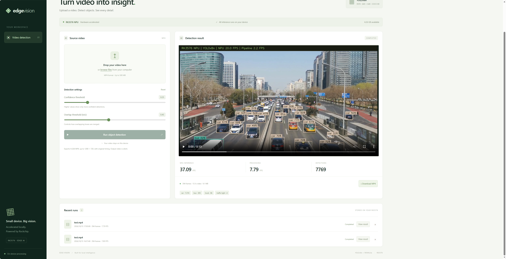

# RK3576 YOLOv8 WebUI

An English video object detection WebUI running directly on the Seeed Studio
reComputer RK3576 Dev Kit. Upload an MP4 from a PC, run YOLOv8n on the Rockchip
NPU, then play, seek, or download an H.264 MP4 with boxes, class labels, confidence
scores, and FPS overlays.



## Features

- Real RK3576 NPU inference using the existing RKNNLite installation
- Precompiled YOLOv8n INT8 model; no conversion or training
- Upload progress, processing previews, cancellation, and run history
- Adjustable confidence and IoU thresholds
- Browser playback, byte-range seeking, and annotated MP4 download
- Storage checks and deletion of old runs
- Python standard-library HTTP server; no additional web framework required

## Project layout

```text
rk3576-webui/       Device application, model, frontend, and deployment notes
video/test.mp4     Included source clip for end-to-end testing
verification/     Measured test reports and annotated example images
fetch_assets.py   Download upstream model/assets and verify model SHA-256
verify_webui.py   HTTP workflow and output-download checks
verify_lifecycle.py  Busy/cancel/delete lifecycle checks
```

## Run on RK3576

The tested device already has Python 3.11, RKNN Toolkit Lite2 2.3.2, OpenCV 4.6,
NumPy, RKNN Runtime 2.3.0, and NPU driver 0.9.8. Reuse these dependencies.

Copy `rk3576-webui/` to the device. For the original deployment:

```sh
cd /home/seeed/codex-yolov8-webui
# Verify real NPU inference before starting the WebUI:
/home/seeed/venvs/rknn-lite2-test/bin/python -B probe.py
sh start.sh
```

Open `http://<device-ip>:8080` from a PC on the same LAN. The original deployment
uses `http://192.168.3.120:8080`.

`start.sh` uses the existing Python environment at
`/home/seeed/venvs/rknn-lite2-test/bin/python`. Adjust that application script if
your device uses a different environment. No driver installer, system service,
firewall change, or system configuration change is included. Start manually again
after reboot. See [deployment documentation](rk3576-webui/README.md) for details.

## Actual-device verification

The included `video/test.mp4` was uploaded through the browser UI and processed
in full on the RK3576. The resulting video played in the browser, downloaded
successfully, and all downloaded frames decoded on the PC.

| Measurement | Result |
| --- | --- |
| Source | 3840 × 2160, 29.97 FPS, 394 frames |
| Output | H.264 MP4, 1280 × 720, 13.146 seconds |
| NPU inference throughput | 37.63 FPS |
| Complete video pipeline throughput | 7.89 FPS |
| Processing time | 49.92 seconds, excluding upload and NPU startup |
| Detection instances across frames | 7,769 |
| Observed classes | car, bus, truck, traffic light |

Inference FPS measures time inside RKNNLite inference. Pipeline FPS also includes
video decoding, preprocessing, postprocessing, drawing, and encoding. Detection
counts represent instances across frames, not unique tracked objects.

Invalid uploads, range requests, concurrent job rejection, cancellation, and
active-run deletion protection were also checked. See
[workflow report](verification/report.json) and
[lifecycle report](verification/lifecycle.json).

## Model provenance and licenses

The precompiled model comes from
[RKNNAI/RK3576-CNN-yolov8n](https://huggingface.co/RKNNAI/RK3576-CNN-yolov8n),
pinned to revision `5062767692fac53f9d69125abf8edf9d891bff4e`.
Its SHA-256 was verified against the publisher's checksum file:

```text
dcd13f14741074625ffbedd7829eaceede3d3faab6cd6a333be616829ac2d197
```

The original model license (AGPL-3.0), publisher documentation, and exact download
URL are preserved under [`rk3576-webui/models/`](rk3576-webui/models/).
Postprocessing is adapted from the official
[Rockchip Model Zoo v2.3.2 YOLOv8 example](https://github.com/airockchip/rknn_model_zoo/blob/v2.3.2/examples/yolov8/python/yolov8.py).
The original example and Apache-2.0 license are retained in
[`rk3576-webui/vendor/`](rk3576-webui/vendor/). NumPy replaces Torch for DFL.
See [third-party notices](THIRD_PARTY_NOTICES.md).

The model's embedded compiler version is 2.4.2 and the existing runtime is 2.3.0.
RKNN emits a version warning; the documented semantic and full-video tests passed
on the actual device without replacing the runtime.

## License

Original application code is licensed under the [MIT License](LICENSE).
Third-party components retain their existing licenses: the bundled YOLOv8n model
is AGPL-3.0, and the Rockchip example and derived postprocessing are Apache-2.0.
The MIT license does not replace these licenses or grant rights to the test video
or other third-party media. See [third-party notices](THIRD_PARTY_NOTICES.md).

## Limits

- Trusted LAN use; no login, TLS, or public exposure configuration
- MP4 uploads up to 500 MiB and input resolution up to 4K
- Output fits 1280 × 720 while preserving aspect ratio, source FPS, and duration
- Output video is silent; audio is not retained
- One processing job at a time; no CPU inference fallback
- Device uploads and results are runtime data and excluded from Git

The source test clip is included by the project owner's request. It is not
covered by the upstream code or model license notices.
